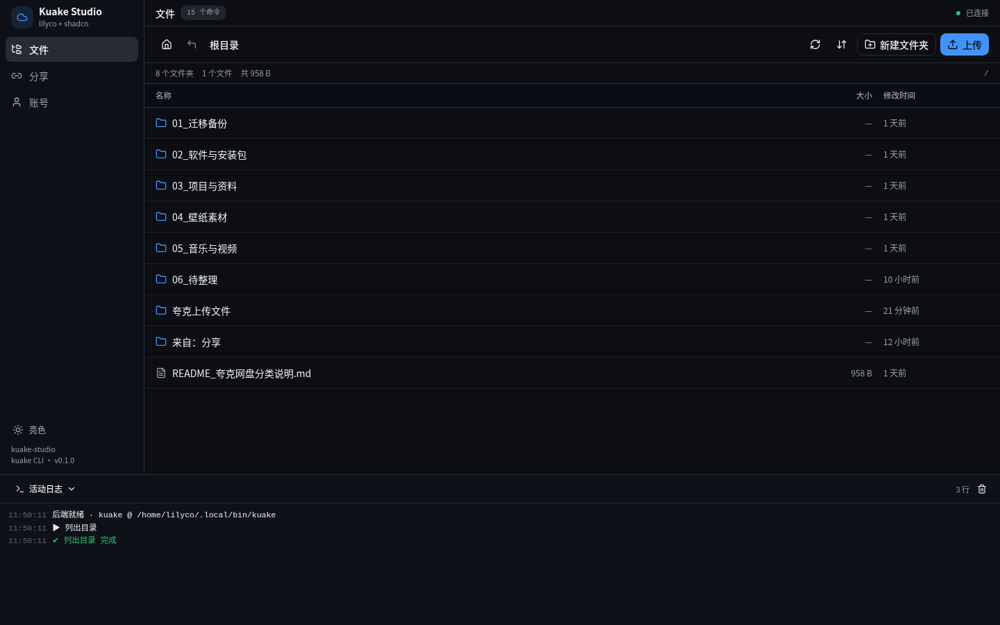
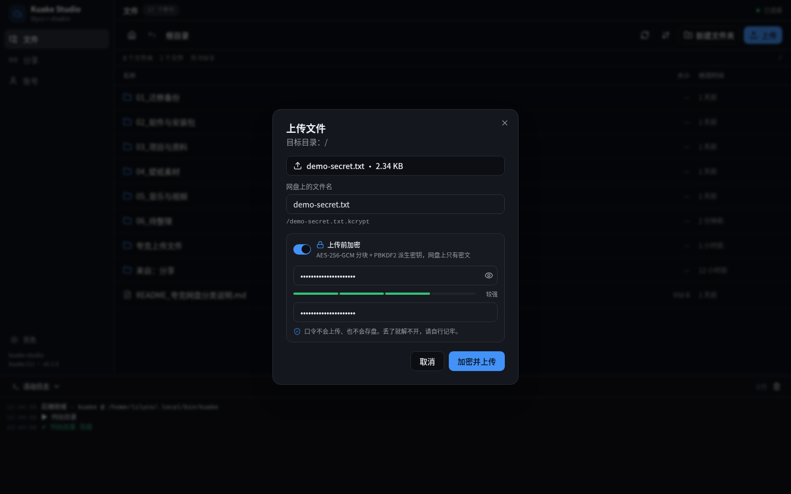
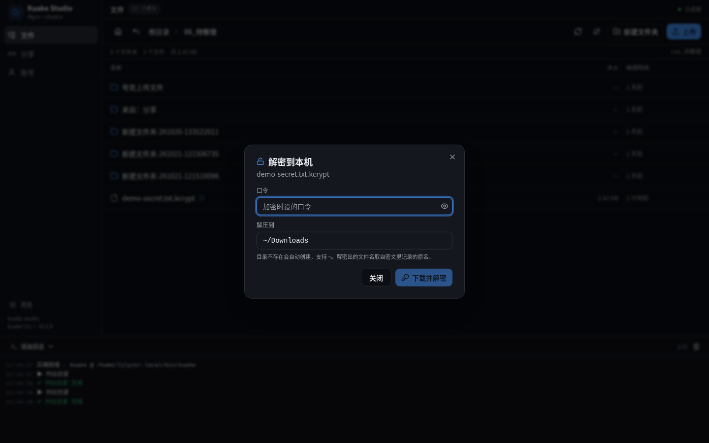
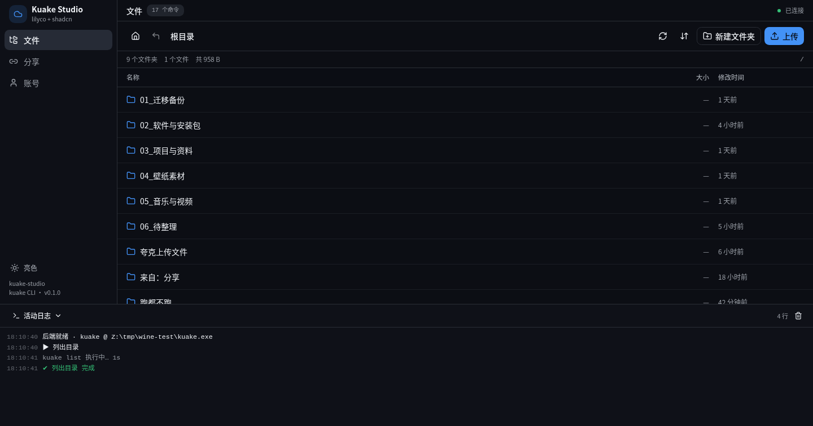
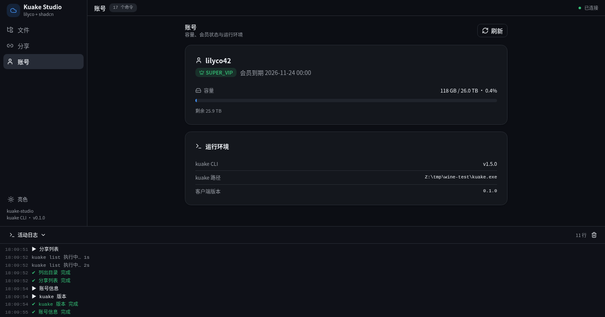
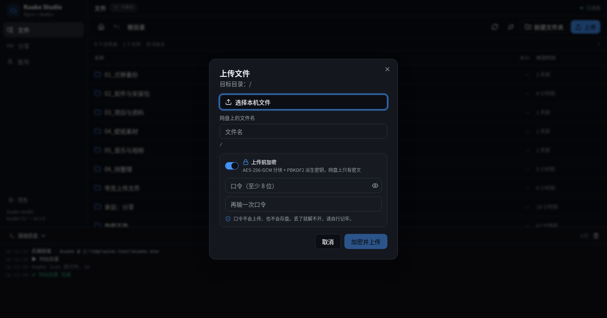

# Kuake Studio

夸克网盘桌面客户端。**Rust 后端用 [lilyco](https://github.com/lilyco-42/lilyco) 框架**（一个 `App`/`Registry`
派生同时驱动 CLI / Web / MCP 三端），**前端用 shadcn/ui**（radix-ui + Tailwind 4 + cva + lucide + sonner），
网盘操作默认走**内置自研夸克 API**（`src/quark.rs`，reqwest 直连官方 HTTP 接口）；
设 `KUAKE_STUDIO_BACKEND=cli` 才回退到本机 `kuake` CLI 子进程。



## 跑起来

### 直接装（推荐）

去 [Releases](https://github.com/lilyco-42/kuake-studio/releases) 下对应平台的包：

| 平台 | 包 | 用法 |
| --- | --- | --- |
| Windows | `*-windows-x64.msi` | 双击安装，开始菜单里点 kuake-studio；卸载前先退出 exe |
| Windows | `*-windows-x64.zip` | 解压后双击 `run.bat`（便携，不写注册表） |
| Linux | `*-linux-x64.tar.gz` | 解压后 `./start.sh`，或把 `kuake-studio` + `dist/` 一起放任意目录 |
| macOS | `*-macos-universal.tar.gz` | 解压后双击 `kuake-studio.app`（未签名，首次打开需右键 → 打开），或 `./kuake-studio` |

三种包都自带 `dist/`（前端产物放在 exe 同级），启动后自动开浏览器到
`http://127.0.0.1:8787`。**默认不再需要安装 `kuake.exe` / `kuake` CLI**：内置原生后端
只要 cookie 就能跑；仅当显式设 `KUAKE_STUDIO_BACKEND=cli` 时才需要本机 CLI。

### 从源码编译

```bash
cargo build --release
cd frontend && bun install --frozen-lockfile && bun run build
cd .. && ./run.sh                  # 开发时用本机共享 target
```

本机（开发机）的 `run.sh` 指向共享编译缓存 `~/.cache/lilyco-build/target`，
普通用户请使用上面打包版自带的启动器。

### 同一个二进制，三种用法

```bash
./run.sh --cli list --path /                    # 终端里跑（lilyco CLI 后端，参数一律 --name 形式）
./run.sh --cli list --path / --json             # 单个 JSON 结果
./run.sh --cli list --path / --json-stream      # 事件流
./run.sh --cli upload --file ~/a.zip --dest /03_项目与资料/a.zip
./run.sh --cli list --help                      # 每个命令的 --help 都由 schema 生成
./run.sh --cli share --path=/x --days 7 --passcode       # 生成提取码（passcode 是 flag）
KUAKE_STUDIO_BACKEND=cli ./run.sh --cli list --path / --json  # 回退到本机 kuake 子进程
./run.sh --mcp                                  # 以 MCP server 暴露给 AI
./run.sh --schema                               # 打印 17 个命令的 JSON Schema
./run.sh --cli list --openai-tool               # 顺便白送 OpenAI/Anthropic/Gemini tool 定义
```

## 功能

| 页面 | 能力 |
| --- | --- |
| 文件 | 目录浏览、面包屑/历史栈、排序（名称/时间/大小）、新建文件夹、上传（可选**上传前加密**）、重命名、移动、复制、删除、详情、下载、**解密到本机**、创建分享 |
| 分享 | 我的分享列表（有效期/浏览/转存）、复制链接、浏览器打开、取消分享、转存他人分享 |
| 账号 | 昵称、会员类型与到期、容量占用进度、网盘后端类型与版本 |
| 活动日志 | 每次调用的实时进度/耗时/错误，可折叠、可清空 |

17 个命令：`list` `info` `user` `version` `download` `share-list` `create` `upload` `move`
`copy` `rename` `delete` `share` `share-delete` `share-save` `encrypt` `decrypt`。

## 架构

```
浏览器 (React 19 + shadcn/ui + Tailwind 4)
   │  GET /api/boot  握手拿一次性令牌
   │  GET /api/schema  读 CommandSchema[] → 表单/对话框全部由 schema 驱动
   │  POST /api/run {cmd,args} → {session_id}
   │  GET /api/progress/{sid}  SSE  ← lilyco-core 的 Progress 事件流
   ▼
axum 0.8 (127.0.0.1 only, 回环 Host/Origin 校验 + 常量时间令牌)
   ▼
lilyco Registry (17 个 #[derive(App)] 命令, SafetyTier T0 只读 / T1 需确认)
   ▼
内置原生夸克 API（src/quark.rs：reqwest 直连官方 HTTP；cookie 来自 .env）
   └─ 可选 KUAKE_STUDIO_BACKEND=cli → kuake CLI 子进程（argv 数组、可取消、900s 超时）
```

关键点：**界面不是手写 17 套表单**。后端 `GET /api/schema` 把 lilyco 每个命令的
`CommandSchema`（参数名/类型/枚举/范围/必填/默认值）交给前端，前端用一套
`SchemaForm` 渲染出对应控件，`CommandDialog` 提交时只发送 schema 声明过的键。
加命令只需要在 `src/apps.rs` 里加一个 struct。

## 原生夸克 API 后端（默认）

从 v0.2.0 起，15 条网盘命令全部由 \`src/quark.rs\` 直接调夸克官方 HTTP 接口实现，
**不再 fork 本机 \`kuake\` 进程**；\`encrypt\` / \`decrypt\` 仍是纯本机命令。

- 覆盖：账号 / 列目录 / 详情 / 新建 / 重命名 / 移动 / 复制 / 删除 / 上传 / 下载 /
  分享（创建、列表、删除、转存）。返回体逐字复刻 kuake CLI 的
  \`{success,code,message,data}\` 信封，所以前端、SSE、MCP、\`--schema\`、17 个命令全都不用改。
- 登录态仍用 \`KUAKE_COOKIE\`（或 \`KUAKE_PUS\` + \`KUAKE_PUUS\`），来源照旧是
  \`~/.config/kuake/.env\`；没有凭据会直接提示运行 \`tools/dump-cookies.mjs --write-env\`。
- 上传实现了 \`upload/pre → update/hash（秒传）→ 分片 PUT → CompleteMultipartUpload → finish\`：
  4 MiB 分片、第 2 片起带 \`X-Oss-Hash-Ctx\`（手写 SHA1 中间态，含 \`Nl/Nh\` 高低 32 位拆分）、
  commit 的 \`Content-MD5\` 与 \`x-oss-callback\` 都按 OSS 签名要求构造。
- 下载用完整的浏览器 Cookie + \`Chrome/146\` UA 取 OSS 直链，流式落盘、可取消、同名自动加 \` (1)\`；
  这一步顺带避开了旧 kuake CLI 长期存在的 \`403 auth expired\`（它的请求构造问题，不是 cookie 缺项）。
- 删除 / 移动 / 复制 / 分享是异步任务：拿到 \`task_id\` 后轮询到 \`status==2\` 才返回成功，
  避免 UI 刚点完还看到旧文件。转存自己的分享会被夸克以 \`41017\` 拒绝，客户端翻成人话提示。
- 想对照旧行为或临时排障：\`KUAKE_STUDIO_BACKEND=cli ./run.sh\`；
  \`/api/boot\` 里的 \`backend\` 字段会标明当前是 \`native\` 还是 \`cli\`，账号页也直接显示。

> 动机：Windows 发布包本来不含 \`kuake.exe\`（上游只发源码、AGPL），Android 也跑不了 Linux ELF
> 子进程；原生后端把这条外部依赖彻底去掉，同时避开上游 CLI 的若干 bug。实现只对照公开接口
> 实测与 AGPL 源码的**语义**，没有复制其代码。

## 安全

- 只绑 `127.0.0.1`；`Host` 非回环直接 403。
- `POST /api/run` `/api/upload` `/api/cancel` 必须带本次启动随机生成的
  `X-Kuake-Token`（常量时间比对）+ 回环 `Origin`，失败 401。
  `GET /api/boot` 故意不返回 CORS 头，别的站点读不到令牌。
- 静态资源带 CSP：`default-src 'self'; script-src 'self'; connect-src 'self'; frame-ancestors 'none'`。
- 上传暂存文件落在 `$TMPDIR/kuake-studio-uploads/`，文件名做净化（去路径、限长、过滤 `..`）。

## 凭据：cookie 会过期，一键刷新

夸克网盘的所有操作都靠 `KUAKE_COOKIE`。它存在 **`~/.config/kuake/.env`**，是唯一的真相来源
（`run.sh` 启动时会 source 它，客户端的 `load_env_fallback()` 也以它为准）。

过期了（下载报 `403 auth expired`）不用去 F12 手抄，直接：

```bash
cd ~/code/kuake-studio/tools
./dump-cookies.mjs --write-env     # 从本机 Chrome 的 cookie 库解密出夸克 cookie，写进 .env
```

它**不启动浏览器、不连 CDP**：拷贝 Chrome 的 Cookies SQLite → 用 keyring 里的口令解密
（kwallet-query 优先，secret-tool 兜底）→ 同名去重 → 写 env。刷新完重启客户端即可。

常用参数：`--json`（机读输出）、`--verbose`（逐条显示解密状态）、`--out <path>`（另存）、
`--domain quark.cn`、`--profile ~/.config/google-chrome/Default`。

> 坑：写进 .env 的 `KUAKE_COOKIE` 值**必须用单引号包裹**——cookie 里有空格和分号，
> 裸写会被 `source` 拆成多条命令。脚本已经处理，手改时别丢引号。

## 上传前加密（.kcrypt）

网盘不该看到你的明文。上传对话框里打开「上传前加密」，填一个口令，文件会先在**本机**
加密成一个 `.kcrypt` 容器再上传——网盘上只有密文。

- **算法**：PBKDF2-HMAC-SHA256（随机 16 字节 salt，默认 200000 轮）派生 256 位密钥，
  之后按 1 MiB 分块用 AES-256-GCM 加密，每块独立 nonce + 认证标签 ⇒ 任何一块被改动、
  截断、乱序都会被检出，不会静默解出错误内容。
- **容器头**：魔数 + 版本 + KDF 参数 + salt + **原始文件名** + 原始大小，所以解密不需要
  额外元数据文件，落地时自动还原成原名（重名自动加 ` (1)`）。
- **口令不上传、不落盘**。它只在本次进程内存里活几秒，用完即弃。**丢了就解不开**——
  没有后门、没有找回途径。
- 前端强制口令 ≥ 8 位且两次输入一致，并给出强度条；后端 `crypt.rs` 也会再校验一次。



解密在客户端里是「**下载 → 本机解密**」两步（明文永不经过网盘接口）：

- UI：文件列表里 `.kcrypt` 文件带锁形图标（见 `screenshot-encrypted.png`），
  行尾菜单多出「解密到本机…」（见 `screenshot-decrypt-menu.png`）。


- CLI：
  ```bash
  ./run.sh --cli encrypt --file ~/a.bin --passphrase 'my long pass' --json
  ./run.sh --cli upload --file ~/a.bin.kcrypt --dest /dir/a.bin.kcrypt
  # 上传时一步到位（本机加密后只传密文，临时文件自动删）
  ./run.sh --cli upload --file ~/a.bin --dest /dir/a.bin.kcrypt --passphrase 'my long pass'
  ./run.sh --cli download --path /dir/a.bin.kcrypt --dest ~/Downloads --json
  ./run.sh --cli decrypt --file ~/Downloads/a.bin.kcrypt --out-dir ~/Downloads --passphrase 'my long pass' --json
  ```

> 注意：`.kcrypt` 是**本客户端自有格式**，不是标准 age/gpg 容器；只保证本客户端能解开。

## 已知限制

### 默认原生后端

1. 仍需新鲜的夸克 cookie；过期后所有接口都会失败，跑一次 `dump-cookies.mjs --write-env` 即可。
2. `share` 对违规文件仍可能被夸克判为「没有可分享的文件」；客户端会回查分享列表确认
   到底建没建成，没建成则提示改分享上级目录。夸克分享目录时会静默跳过其中的违规文件。
3. `share-days` 只有 **0 / 1 / 7 / 30**（夸克服务端限制），已做成下拉框。
4. `share-list` 的 `size` 上限 **100**；`share-delete` 只认 `share_id`，不认 `pwd_id`。
5. 不能转存**自己**创建的分享（夸克账号级限制 `41017`），需换另一个账号的链接。
6. `download` 的 dest 被规整成**目录**（不存在自动建，支持 `~`）；`upload` 的 dest 必须是
   **完整文件路径**，同名已存在返回 `SKIPPED`，客户端转成明确错误，不会静默覆盖。

### 回退到 kuake CLI（`KUAKE_STUDIO_BACKEND=cli`）

1. **`download` 的 dest 语义是二义的**（原材料行为）：dest 指向**已存在的目录** → 文件放进去；
   指向**不存在的路径** → 直接被当成完整文件名写出去，于是 `dest=/tmp/dl` 会得到一个叫 `dl`
   的**文件**而不是目录 `dl/`。本客户端已在调用前把 dest 规整成目录（`~` 展开 + `mkdir -p` +
   存在但是文件则明确报错），所以从 UI/CLI/MCP 走都是「目录」语义。
2. `upload` 的 dest **必须是完整文件路径**（含文件名），否则 kuake 会返回
   `success:true + code:SKIPPED` 假成功——本客户端已把这种假成功转成明确错误。
3. `copy`/`move` 的 dest 必须是**已存在的目录**（与 upload 语义相反）。
4. `share-delete` 只认 `share_id`（不是 `pwd_id`/`share_url` 里的那串）。
5. `share-list` 的 `size` 上限是 **100**（客户端 schema 已按此收敛，填更大后端直接报错）。
6. `share` 对**违规文件**会返回 `401 require login [guest]`（kuake 异步轮询分支没带 cookie，
   是它的 bug，不是登录失效）。本客户端会回查分享列表确认到底建没建成：真建成了就把
   `share_id` 恢复出来；没建成则报人话错误，提示「该文件可能违规，试试分享它所在的目录」。
   夸克本身也支持分享**目录**——目录里的违规文件会被静默跳过。
7. `share` 的 `days` 只接受 **0 / 1 / 7 / 30**，客户端已做成下拉框（永久/1 天/7 天/30 天）。
8. 旧版 `download` 曾长期报 `403 auth expired`（上游请求构造问题）；原生后端已规避，
   CLI 回退时可用新 cookie 缓解。

## 各平台构建（GitHub Actions）

`.github/workflows/build.yml` 在推分支 / 推 `v*` 标签 / 手动时跑：

1. `check`：`cargo fmt --check` + `clippy -D warnings` + `cargo test`（Ubuntu，几十秒）。
2. `package`：三个平台并行，各先 `bun install --frozen-lockfile` → `tsc --noEmit` →
   `vite build` → `cargo build --release`，再自检 `--schema` 与 `/api/boot`：
   - **windows-x64**：便携 `.zip` + WiX v3 的 `.msi`（exe 图标/版本信息由 `build.rs` + `embed-resource` 编进去）。
   - **linux-x64**：`tar.gz`（含 `start.sh`、`.desktop`、png 图标）。
   - **macos-universal**：分别编 arm64 / x86_64 再 `lipo` 合成，出 `tar.gz` + 带 icns 的 `.app`。
3. `release`：打 `v*` 标签时把三平台产物传到 GitHub Release。

想手动出包：Actions → build → Run workflow（填 tag 会顺带发布）。
前端 `bun.lock` 里钉的是国内镜像，CI 里会先替换成 npmjs 官方源再 frozen 安装。

## 实测记录：Windows 包在 Wine 里跑过

发布后用 **Wine 11.21**（win64 prefix）真跑了 `v0.1.0` 的 Windows 产物，不只是交叉编译检查。
> 注意：下面是**切换原生后端之前**的历史记录；从 v0.2.0 起 Windows 包不再需要 `kuake.exe`。

| 项目 | 结果 |
| --- | --- |
| 便携包 `.zip` | `--schema` 返回 17 条命令；起在 8791 后 `/api/boot`、`/`、`dist` 静态资源、`/api/schema` 全 200 |
| 回环安全闸 | 无令牌 POST → 401；伪造 Origin → 403；未知命令 / 缺必填 → 400 |
| CLI 的 Windows 分支 | `encrypt` / `decrypt` 2.5 MB 随机文件（3 块）往返，`cmp` 与原文一致；`--help` 正常 |
| SSE 进度 | `POST /api/run` → `GET /api/progress/{sid}` 收到 3 个 tick + done，日志含 KDF 轮数 |
| MSI 安装 | 独立 prefix 静默安装 → 6 个文件齐全、开始菜单快捷方式、注册表 DisplayName/Version；安装版起 8793 正常 |
| MSI 卸载 | **装完不启动 exe 直接卸载**：安装目录完全删除，快捷方式与注册表清空 |
| 真实网盘闭环 | 交叉编译 `kuake.exe`（Go `GOOS=windows GOARCH=amd64`）后：`user` / `list` / `info` / `share-list` / `download` 全 OK；2.5 MB 文件加密上传 → 回下 → 解密 → `cmp` 与原文件一致 |
| 前端 UI | Linux Chrome 直连 Wine 后端：文件 / 分享 / 账号三视图渲染，上传对话框与「上传前加密」开关可用，控制台 0 报错 |







三个边界：

1. 这是 **Wine 11.21**，不是真 Windows 机器；真机上的 MSI 升级路径未验。
2. `v0.1.0` 的 Windows 包**不含 `kuake.exe`**（上游只发源码，本项目不重分发）。当时实测用
   上面那条 Go 命令编译出 exe 后由 `KUAKE_BIN` 指过去，否则每个网盘命令都会报
   `无法启动 kuake（kuake）：program not found`。**原生后端已不再有此限制**。
3. 静默卸载时若 `kuake-studio.exe` 仍在运行，Windows/Wine 会跳过删除该 exe 并留下空壳目录：
   先退出客户端（或任务管理器结束进程）再卸载即可。干净复测已证明 WiX 包本身卸载干净。

### v0.2.0：原生后端在 Wine 里再跑一遍

`v0.2.0` 的 Windows 便携包（`kuake-studio.exe` 7.7 MB，含静态链接的 rustls）**不装 `kuake.exe`、
不设 `KUAKE_BIN`**，只给 `KUAKE_COOKIE`，在 Wine 11.21 上复测：

| 项目 | 结果 |
| --- | --- |
| 启动 | `/api/boot` → `backend: "native"`、`version: "0.2.0"`；`/` 200 且含 `<div id="root">` |
| 只读命令 | `user` → lilyco42 / SUPER_VIP / 26.0 TB；`version` → `native 0.1.0`；`list /` → 10 项；`info README` → 958 B |
| 真实网盘闭环 | `create` → `upload`（300043 B）→ `download` → `cmp` 与原文**逐字节一致** → `delete` 清理；残留 0 |
| 关键结论 | 上游 CLI 的 `403 auth expired`、`program not found` 都不再出现；Windows 包开箱即用 |
## 目录

```
src/main.rs       入口：--cli / --mcp / --schema / 默认 Web
src/apps.rs       17 个 #[derive(App)] 命令（lilyco 派生宏）
src/crypt.rs      .kcrypt 容器：AES-256-GCM 分块 + PBKDF2-SHA256 派生密钥
src/quark.rs      自研夸克 API：reqwest 直连官方接口，复刻 CLI 信封（默认后端）
src/kuake.rs      kuake CLI 回退后端 + 单点拦截（脏行解析、取消、超时、进度）
src/server.rs     axum 宿主：boot/schema/run/progress/cancel/upload + 静态托管
src/security.rs   回环闸 + 令牌
src/paths.rs      HOME / USERPROFILE 与 ~ 展开（Windows 兼容）
build.rs          Windows 目标嵌 exe 图标与版本信息
wix/main.wxs      WiX v3 安装包源（文件清单由 heat 生成）
.github/workflows/build.yml   三平台 CI / 出包 / 发 Release
tools/dump-cookies.mjs  从本机 Chrome cookie 库解出夸克 cookie 并刷新 ~/.config/kuake/.env
frontend/src/components/ui/   shadcn/ui 组件（基于 radix-ui 聚合包手写）
frontend/src/components/      schema-form / command-dialog / 文件表格 / 控制台
frontend/src/lib/             api / store / types / format
```
