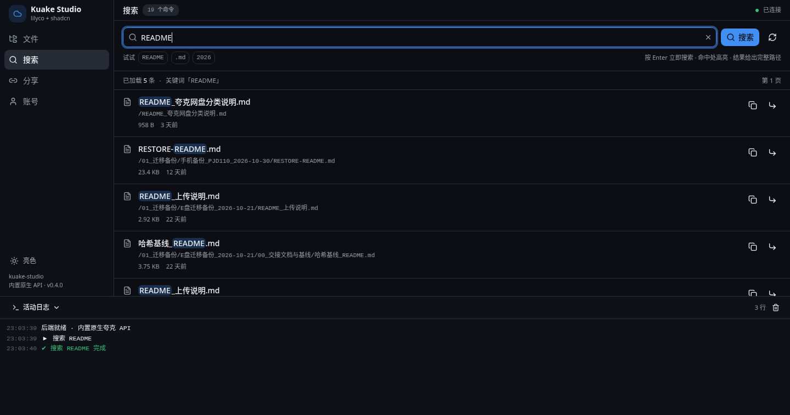
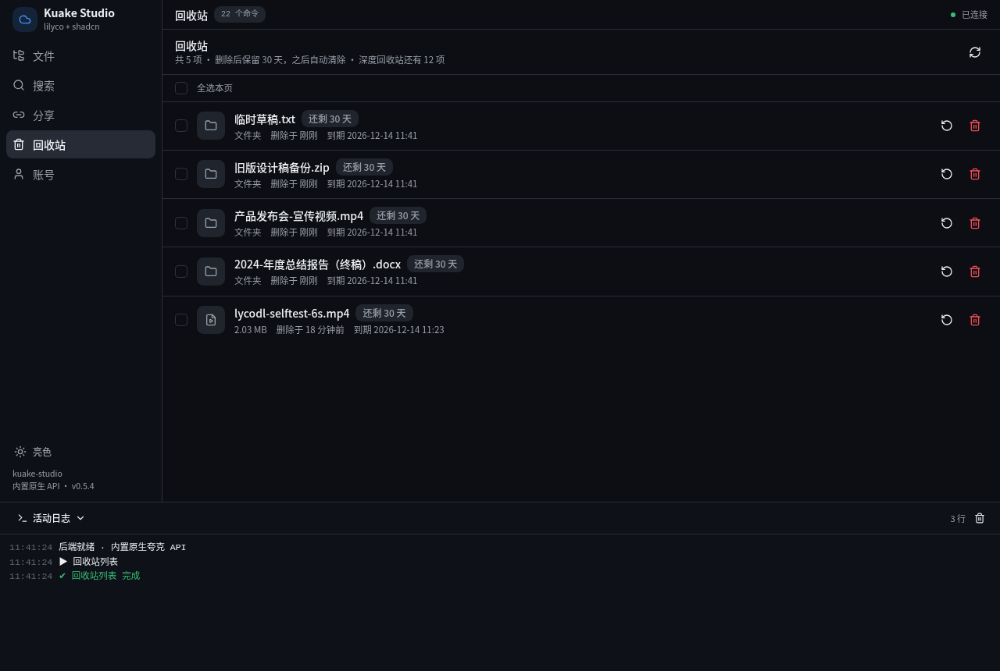
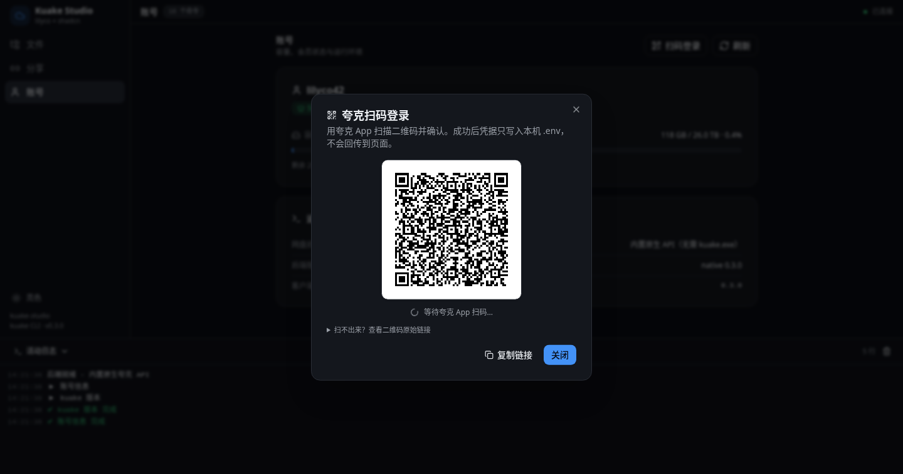

# Kuake Studio

夸克网盘客户端（Windows / Linux / macOS 桌面安装包 + **Android 可安装 APK** + iOS / 鸿蒙进程内原生库）。
**Rust 后端用 [lilyco](https://github.com/lilyco-42/lilyco) 框架**（一个 `App`/`Registry`
派生同时驱动 CLI / Web / MCP 三端），**前端用 shadcn/ui**（radix-ui + Tailwind 4 + cva + lucide + sonner），
网盘操作默认走**内置自研夸克 API**（`src/quark.rs`，reqwest 直连官方 HTTP 接口）；
设 `KUAKE_STUDIO_BACKEND=cli` 才回退到本机 `kuake` CLI 子进程。

四个消费端平台发**可直接安装的包**：Windows / Linux / macOS 是桌面包（自带 axum + 浏览器），
Android 是 **APK**（WebView 宿主 + 进程内 axum，双击图标即用）；
iOS / 鸿蒙发**进程内 FFI 静态库**（宿主 App 自己链原生层 + WebView 渲染同一份 `dist/`）。
不发假 App、不假称商店上架，详见 [六平台支持矩阵](#六平台支持矩阵)。


## 跑起来

### 直接装（推荐）

去 [Releases](https://github.com/lilyco-42/kuake-studio/releases) 下对应平台的包：

| 平台 | 包 | 用法 |
| --- | --- | --- |
| Windows | `*-windows-x64.msi` | 双击安装，开始菜单里点 kuake-studio；卸载前先退出 exe |
| Windows | `*-windows-x64.zip` | 解压后双击 `run.bat`（便携，不写注册表） |
| Linux | `*-linux-x64.tar.gz` | 解压后在目录里运行一次 `./install.sh`（装桌面图标 + 开机自启）；或 `./start.sh` 便携启动 |
| macOS | `*-macos-universal.tar.gz` | 解压后双击 `kuake-studio.app`（未签名，首次打开需右键 → 打开），或 `./kuake-studio` |
| Android | `*-android.apk` | 传到手机点安装（首次需允许「安装未知来源应用」），装完点图标即用 |

三种包都自带 `dist/`（前端产物放在 exe 同级），启动后自动开浏览器到
`http://127.0.0.1:8787`。**默认不再需要安装 `kuake.exe` / `kuake` CLI**：内置原生后端
首次在「账号」页点「**扫码登录**」用夸克 App 扫一下即可，无需手抄 cookie；仅当显式设 `KUAKE_STUDIO_BACKEND=cli` 时才需要本机 CLI。

### 小白：全程不用碰 IP / 端口

三个桌面平台都是**双击图标 → 程序自动开浏览器**，用户永远不用在地址栏输入
`127.0.0.1` 或 `8787`（端口由程序内部监听，URL 一眼都不用看）：

| 平台 | 第一次 | 以后每次 | 卸载 |
| --- | --- | --- | --- |
| Windows | 双击 `*.msi` 安装（或解压 `.zip` 双击 `run.bat`） | 点桌面 / 开始菜单的「kuake-studio」 | 设置 → 应用 → 卸载 |
| macOS | 解压 `*.tar.gz`，首次对 `kuake-studio.app` 右键 → 打开（未签名，仅此一次） | 双击 `kuake-studio.app` | 把 .app 拖进废纸篓 |
| Linux | 在解压目录里运行一次 `./install.sh` | 双击桌面的「夸克网盘」 | `./install.sh --uninstall` |
| Android | 把 `*.apk` 传到手机点开安装（允许「未知来源」） | 点桌面的「夸克网盘」图标 | 长按图标 → 卸载 |

Linux 的 `./install.sh` 把程序装到 `~/.local/opt/kuake-studio`，生成桌面「夸克网盘」
图标与应用菜单项，并写一份 XDG 登录项 `~/.config/autostart/kuake-studio.desktop`
作为**开机自启的唯一真源**（托盘菜单「开机自启」勾选框读写的就是这个文件，
不再额外装 `systemd --user` 服务）。`open.sh` 会在服务没起时先拉起再开浏览器。
服务只监听 `127.0.0.1:8787`，局域网内其他机器访问不到；卸载脚本只删程序与入口，
不动凭据和已下载的文件。

> **Android 现在是一份真 APK**（`android/` 独立宿主工程）：`*-android.apk` 里是
> WebView 宿主 + `libkuake_studio_jni.so`（JNI 调同一份 C ABI）+ 内置 `dist.zip`，
> 启动即在 App 进程内起 127.0.0.1 的 axum，界面与桌面包完全一致；arm64 真机与 x86_64
> 模拟器**同一份包**（两套 `.so` 都在 `lib/` 下）。它用 aapt2 + javac + d8 + zipalign +
> apksigner **纯命令行打包**，不需要 Android Studio / Gradle，CI 里直接出包。
> 仍是 debug 自签名、不上应用商店，首次安装需允许「安装未知来源应用」。
> iOS / 鸿蒙还是只发静态库（受签名 / 公证限制更重）。

### 六平台支持矩阵

| 平台 | Release 产物 | 形态 | 谁渲染 UI |
| --- | --- | --- | --- |
| Windows x64 | `*-windows-x64.msi` / `.zip` | 真安装包（自带 dist，自动开浏览器） | 客户端 axum + 系统浏览器 |
| Linux x64 | `*-linux-x64.tar.gz` | 真安装包（同上） | 同上 |
| macOS universal | `*-macos-universal.tar.gz` / `.app` | 真安装包（arm64 + x86_64 lipo，未签名） | 同上 |
| Android | `*-android.apk` | **真安装包**：WebView 宿主 + 进程内 axum + 内置 `dist.zip` | 客户端 axum + App 内 WebView |
| Android arm64（给宿主 App 链） | `*-android-arm64.tar.gz` | `libkuake_studio.a` + C 头 + ABI 自检源码 | **宿主 App**：JNI + WebView |
| iOS arm64 | `*-ios-arm64.tar.gz` | 同上 | **宿主 App**：Swift + WKWebView |
| 鸿蒙 / OpenHarmony arm64 | `*-ohos-arm64.tar.gz` | 同上 | **宿主 App**：NAPI + WebView |

桌面架构是「本机 axum 服务 + 外部浏览器」；Android 复用了同一套后端，但把 axum 跑在
**App 进程内**（`127.0.0.1`），UI 交给 WebView，所以用户看到的是同一个界面、同一套命令。

iOS / 鸿蒙以及 `*-android-arm64.tar.gz` 这三个是**进程内 FFI 原生库**，不是可安装的 App、
没有应用商店签名：同一套 lilyco Registry / 25 条命令 / 前端 `dist/` 全部复用，只是不启 HTTP、
不开浏览器、不生成一次性令牌，宿主在进程内直接调 C ABI。

宿主接法（`include/kuake_studio.h`，6 个函数，全部 UTF-8 / NULL 安全）：

```c
#include "kuake_studio.h"

kuake_studio_set_cookie(cookie_utf8);        // 1) 启动后先注入凭据，成功返回 0
char *schemas = kuake_studio_schemas();      // 2) 25 条命令的 JSON schema 数组
char *out = kuake_studio_call("user", "{}"); // 3) 同步执行，返回标准信封
kuake_studio_free(out);
kuake_studio_free(schemas);
char *boot = kuake_studio_boot();            // 4) mode:"in-process"，不含 token
kuake_studio_free(boot);
const char *v = kuake_studio_version();      // 静态缓冲，勿 free
```

- 除 `version()` 返回静态缓冲（**勿 free**）外，所有 `char*` 必须 `kuake_studio_free()`。
- 全部入口对 NULL / 非法 UTF-8 / panic 有兜底：panic 绝不越过 `extern "C"`，会翻成失败信封
  `{success:false,code:"PANIC",...}`；`boot()` 里没有 token、没有 cookie。
- 库**刻意不读本机 `.env`**（不覆盖宿主注入的凭据）；`--no-default-features` 编出来的库
  不含 axum / tokio / async-stream，纯 Rust 核心 + 同步调用，进度事件发到无人接收的通道不阻塞。
- `tools/abi-selftest.c` 是版本无关的端到端自检（host 架构真链接 `.a` 跑 15 个断言），CI 每次都跑。

> 为什么不套 Tauri 壳：Tauri 2 官方只支持 Android / iOS，**没有鸿蒙 / OpenHarmony**；
> GitHub 的 ubuntu runner 自带 Android NDK 27.3 但没有 DevEco / OHOS SDK，macOS runner 才有 Xcode；
> 这里用 zig 0.17.1 的 aarch64 musl sysroot 交叉编 C，不依赖 NDK / DevEco 的 C 工具链。
> 所以用 Rust 官方 target（`aarch64-unknown-linux-ohos` 等）+ 进程内 FFI，CI 六个平台全都
> **真编译 / 真检查**：产物是 arm64 静态库归档（`crate-type = ["staticlib","rlib"]`，不编 cdylib），
> 逐个查成员架构与 `kuake_studio_*` 符号，不靠 `cargo check` 糊弄（check 不链接，
> 曾漏掉 `cdylib` 交叉链接失败，也漏过 host gcc 混进归档的 x86-64 对象）。

### 从源码编译

```bash
cargo build --release
cd frontend && bun install --frozen-lockfile && bun run build
cd .. && ./run.sh                  # 开发时用本机共享 target
```

本机（开发机）的 `run.sh` 指向共享编译缓存 `~/.cache/lilyco-build/target`，
普通用户请使用上面打包版自带的启动器。

iOS / 鸿蒙（以及给宿主 App 用的 Android 静态库包）只编核心库（不编 axum / tokio / 浏览器入口），
出 `target/<triple>/release/libkuake_studio.a`：

```bash
rustup target add aarch64-linux-android   # 或 aarch64-apple-ios / aarch64-unknown-linux-ohos
# Android / 鸿蒙：用 zig 0.17.1 的 aarch64 musl sysroot 交叉编 ring 的 C（见 CI）
CC_aarch64_linux_android="$PWD/tools/cc-aarch64-musl.sh" \
  AR_aarch64_linux_android=ar \
  cargo build --release --no-default-features --lib --target aarch64-linux-android
```

C 头文件在 `include/kuake_studio.h`，接入方式见[六平台支持矩阵](#六平台支持矩阵)。

**Android 出可安装 APK**（与上面的静态库是两条路，互不影响）：

```bash
cd frontend && bun run build && cd ..            # 1) 前端 dist
./android/tools/build-jni.sh aarch64-linux-android x86_64-linux-android  # 2) 两套 .so
./android/tools/build-apk.sh                     # 3) pkg/kuake-studio-<ver>-android.apk
adb install -r pkg/kuake-studio-*-android.apk    # 4) 装到真机 / 模拟器
```

需要 `ANDROID_SDK_ROOT`（含 `ndk/`、`build-tools/`、`platforms/android-36`）与 JDK 17；
不需要 Android Studio、不需要 Gradle。脚本会自动回退到 `~/Android/Sdk`。
`.so` 收集是按 `android/target/<triple>/release/` 的目录名映射 ABI 的，所以想加 `armeabi-v7a`
只要多传一个 `armv7-linux-androideabi` 给 `build-jni.sh`。

出诊断包（带 `android:debuggable="true"`，方便 `adb shell run-as` 读写 App 私有目录）：

```bash
KUAKE_STUDIO_APK_DEBUGGABLE=1 ./android/tools/build-apk.sh   # → pkg/kuake-studio-<ver>-android-debuggable.apk
```

可调试构建另起文件名，**不会顶替发布用的** `pkg/kuake-studio-<ver>-android.apk`。

### 同一个二进制，三种用法

```bash
./run.sh --cli list --path /                    # 终端里跑（lilyco CLI 后端，参数一律 --name 形式）
./run.sh --cli list --path / --json             # 单个 JSON 结果
./run.sh --cli list --path / --json-stream      # 事件流
./run.sh --cli upload --file ~/a.zip --dest /03_项目与资料/a.zip
./run.sh --cli list --help                      # 每个命令的 --help 都由 schema 生成
./run.sh --cli share --path=/x --days 7 --passcode       # 生成提取码（passcode 是 flag）
KUAKE_STUDIO_BACKEND=cli ./run.sh --cli list --path / --json  # 回退到本机 kuake 子进程
./run.sh --cli search --q README --json        # 全盘搜索文件名（仅内置原生后端）
./run.sh --mcp                                  # 以 MCP server 暴露给 AI
./run.sh --schema                               # 打印 25 个命令的 JSON Schema
./run.sh --cli list --openai-tool               # 顺便白送 OpenAI/Anthropic/Gemini tool 定义
```

## 功能

| 页面 | 能力 |
| --- | --- |
| 文件 | 目录浏览、面包屑/历史栈、排序（名称/时间/大小）、新建文件夹、上传（可选**上传前加密**）、重命名、移动、复制、删除、详情、下载、**解密到本机**、创建分享、**勾选多选后批量移动 / 复制 / 删除**（v0.5.6） |
| 搜索 | **全盘按文件名搜索**、命中高亮、完整路径反查、复制路径、跳到所在目录、分页加载（v0.4.0） |
| 分享 | 我的分享列表（有效期/浏览/转存）、复制链接、浏览器打开、取消分享、转存他人分享 |
| 回收站 | 最近删除列表（删除时间/剩余天数）、勾选后**批量恢复**、**永久删除**、分页加载（v0.5.5） |
| 账号 | 昵称、会员类型与到期、容量占用进度、网盘后端类型与版本、**扫码登录**（一键刷新凭据） |
| 活动日志 | 每次调用的实时进度/耗时/错误，可折叠、可清空 |

25 个命令：`list` `info` `search` `user` `version` `download` `share-list` `recycle-list` `create` `upload`
`move` `copy` `rename` `delete` `share` `share-delete` `share-save` `recycle-restore`
`recycle-purge` `encrypt` `decrypt` `login` `batch-delete` `batch-move` `batch-copy`。

其中 `batch-*` 是 [v0.5.6 文件页多选批量](#文件页多选批量v056) 新增的命令。

**宿主一致性（v0.5.2）**：`#[arg(default = …)]` 写在 schema 里，但除 CLI 外
（clap 会填默认），Web/SSE、MCP、FFI 和嵌入方都是把调用方的 `args` JSON 直接交给
handler。`build_registry()` 现在统一在注册前按 schema 补齐**缺失或 `null`** 的参数，
显式给的值（含 `0` / 空串）一律不覆盖。修掉的实际症状：`search` 不传 `size` 曾只回 1 条
（应为 50）、`share` 不传 `days` 直接报参数错、`login` 不传 `timeout` 只等 10 秒。

## 系统托盘与跨平台快捷方式（v0.5.7）

桌面端（Windows / Linux / macOS）启动后除了自动开浏览器，还会在系统托盘 / 菜单栏
驻留一个图标：**左键打开界面、右键弹菜单**（打开界面 / 开机自启勾选 / 退出）。
关掉浏览器窗口不会退出服务，从托盘「退出」才真正结束。

| 平台 | 托盘实现 | 开机自启唯一登录项 |
| --- | --- | --- |
| Windows | 自跑 Win32 消息泵 | 注册表 `HKCU\...\CurrentVersion\Run` 的 `KuakeStudio` 值（`winreg`） |
| Linux | `ksni` 纯 Rust D-Bus StatusNotifierItem，**零** GTK3 / libappindicator 依赖 | `~/.config/autostart/kuake-studio.desktop`（XDG，可用 `XDG_CONFIG_HOME` 覆盖） |
| macOS | 主线程 `NSStatusItem` + `CFRunLoop` | `~/Library/LaunchAgents/dev.lilyco.kuake-studio.plist`（LaunchAgent） |

三平台的「开机自启」都只控制**一份**登录项，勾选框在 `src/tray.rs` 里直接读写它；
Linux 刻意不再装 `systemd --user` unit——两套并存时托盘取消勾选只能删掉 XDG
那份，systemd 下次登录照样把服务拉起来，「关掉自启」就成了假动作。
没有桌面环境（无 D-Bus StatusNotifierWatcher）时托盘 `build()` 失败会打印一行
提示并**自动降级为纯后台服务**，`/api/boot` 与 Web 界面照常可用，不影响启动。

单实例：重复双击图标 / 运行 exe 会先探活 `/api/boot` 并校验响应里的 `name`
是 `kuake-studio`，认出自家实例就只把浏览器带出来；端口被无关程序占用时不会被
误判成「已在运行」。桌面快捷方式显示名统一为「夸克网盘」；Windows WiX 快捷方式
保留 ASCII 名（candle 没有 codepage 参数，改中文有编码风险），macOS `.app` 的
`CFBundleDisplayName` 已改为「夸克网盘」。

## 全盘搜索（v0.4.0）



「搜索」页按文件名跨整个网盘找文件/目录，命中处高亮，结果直接给**完整路径**：

```bash
./run.sh --cli search --q README --json
./run.sh --cli search --q 音乐 --page 2 --size 30 --json-stream
```

- 官方 `GET /1/clouddrive/file/search` 只回 `fid` 和父 `pdir_fid`，**不回 `path`、也不回 `total`**。
  客户端沿 `pdir_fid` 用 `/file/info` 逐级反查到根（同一批结果共享祖先，按 fid 缓存），
  拼回 `/01_迁移备份/…/README.md` 这样的完整路径 —— 于是 `download` / `rename` / `move` /
  `copy` / `share` / `info` 这些基于路径的命令原样复用，一条都不用改。
- 分页靠「短页即止」：满页（`has_more=true`）时点「加载更多」，不依赖不存在的 `total`。
- 空关键词在前后端都被挡掉（夸克对空 `q` 会当"最近文件"返回，容易误当全盘列表）。
- 高亮 `hl_file_name` 是 `&lt;hl&gt;…&lt;/hl&gt;` 转义文本，前端拆成纯文本片段后用
  `<mark>` 渲染，**绝不 `dangerouslySetInnerHTML`**。
- 逐级反查有 12 层上限、成环检测与单次 150 次请求预算；万一某条祖先链断了，
  该项标 `path_partial: true`、路径留空并在 UI 上禁用「复制路径 / 跳到所在目录」，
  **不会拿半截路径去跑写操作**，其余结果照常可用。

> 边界：`search` 是本客户端自研扩展，上游 `kuake` CLI 没有这条命令，
> 因此 `KUAKE_STUDIO_BACKEND=cli` 回退模式下会明确报「仅内置原生后端可用」，
> 侧栏「搜索」也会禁用；不会伪造一个假的搜索结果。

## 回收站（v0.5.5）



「回收站」页列出最近删除的条目，可以勾选后**批量恢复**或**永久删除**：

```bash
./run.sh --cli recycle-list --json                       # 第一页 50 条
./run.sh --cli recycle-list --page 2 --size 100 --json
./run.sh --cli recycle-restore --records <record_id> [--records <record_id> ...]
./run.sh --cli recycle-purge   --records <record_id>
```

- 三个端点都是在真账号上实测出来的：`GET /1/clouddrive/file/recycle/list`、
  `POST /1/clouddrive/file/recycle/recover`（恢复）、`POST /1/clouddrive/file/recycle/remove`（永久删除）。
  前者的 `data` 里**有 `total`**（比 `/file/search` 强），所以回收站能真分页，
  另外还带 `deep_recycle_stat.deep_recycle_count`；列表页把它显示成「深度回收站还有 N 项」。
- `record_list` 必须是**字符串数组**（`[record_id, …]`）。传对象数组、传 JSON 字符串、
  或把字段写成 `filelist` / 多带一个 `record_list_str`，后端一律回 `14001 Bad Parameter`。
- 恢复是**异步任务**（`recover` 只回 `task_id`），客户端会轮询 `/1/clouddrive/task`
  到 `status==2` 才报成功；永久删除是同步的（`data.finish` 直接为 `true`）。
- `select_mode` 必须写死 `2`（按 `record_list` 指定条目）。**`select_mode=1` 是「全部」语义** ——
  传 `{select_mode:1, record_list:[]}` 会把整个回收站的内容全恢复，绝不能拿它当探针。
- 恢复**不存在的 record_id** 也回 `code=0` + 一个永远不完成的 `task_id`，所以客户端不靠
  `code=0` 判定成功，只看 `wait_task` 的轮询结果（超时就报错，不会假装恢复成功）。
- 条目自带 `move_recycle_at`（删除时间）与 `move_deep_recycle_at`（进深度回收站的时间，
  恒为前者 + 30 天），`invisible_remain` 是剩余毫秒。客户端换算成「还剩 N 天」，
  **≤3 天标红**；不足一天按一天算，不会出现「还剩 0 天但还能点」的歧义。
- `recycle-restore` / `recycle-purge` 是 `safety="t1"`（写操作），Web 端走确认对话框；
  `recycle-list` 是 T0 只读。`records` 在 schema 里是 `list` 类型，
  前端 `SchemaForm` 渲染成「每行一个」的文本框，空行会被剔掉。

## 文件页多选批量（v0.5.6）

「文件」页现在每行有 checkbox、表头可全选：勾中后出现「已选 N 项」操作条，
可一次**批量移动 / 批量复制 / 批量删除**。

```bash
./run.sh --cli batch-delete --paths /06_待整理/a /06_待整理/b
./run.sh --cli batch-move   --dest /06_待整理/d1 --paths /a /b
./run.sh --cli batch-copy   --dest /06_待整理/d2 --paths /a /b
```

- 三条命令都是 T1 写操作，Web 端走确认对话框；`paths` 在 schema 里是
  `list` 类型，前端用 `preset` 把勾中项的完整路径数组直接透传、并隐藏该字段，
  用户只需在对话框里改目标目录 `dest`（默认当前目录）。
- 底层一条请求打完：`POST /1/clouddrive/file/{delete,move,copy}` 的
  `filelist` 一次传多个 `fid`（move/copy 另带 `to_pdir_fid`），拿到**单个**
  `task_id` 后轮询到 `status==2`，返回体带 `count`。单条 `delete` / `move` /
  `copy` 的形状完全没变，仍走同一个 `batch_body()` 构造，只是 `filelist` 长度为 1。
- 写操作前逐条 `resolve()` 把路径换成 fid，**任一路径解析失败就整体中止**，
  不会发一个掺了失效 fid 的半成品请求（夸克对失效 fid 回 `400 / 14001 Bad Parameter`）。
- 勾中项的身份用 `fid`；列表刷新后按本页存活 fid 自动剔除失效选中项，
  切换目录、刷新、失败都会清空选择，不会把上一页的选择带到下一页。

### 实测记录：批量端到端（v0.5.6）

真实账号上用 8787 的 HTTP/SSE 通道跑完一整轮，5 个探针目录全部清干净：

| 步骤 | 命令 | 结果 |
| --- | --- | --- |
| 造目标 | 5× `create {name, pdir:/06_待整理}` | 5 个目录创建成功 |
| 批量复制 | `batch-copy {paths:[3 个], dest:__ks_b56_d1__}` | `批量复制成功`、`count=3`，`list d1` 得 3 项 |
| 批量移动 | `batch-move {paths:[d1 里 3 个], dest:__ks_b56_d2__}` | `批量移动成功`、`count=3`，`list d2` 得 3 项 |
| 批量删除 | `batch-delete {paths:[5 个顶层]}` | `批量删除成功`、`count=5`，`list` 里探针 0 项 |
| 清场 | `recycle-purge {records:[5 个 record_id]}` | `已永久删除`；`recycle-list` 的 `total` 回到 1、残留 0 |

`cargo test --locked --lib` 62 项全过（含 `batch_body` 形状、argv 约定、
三条 schema 的 `list` 参数与 T1 标记），`cargo clippy -- -D warnings` 零警告；
前端 `npm run typecheck` / `npm run build` 通过。

发版产物也跑过运行态：从 `kuake-studio-0.5.6-linux-x64.tar.gz` 解出的原生二进制
用 `start.sh --port 8795` 起在回环上，`/api/boot` 报 `version=0.5.6 / backend=native`，
`GET /` 返回内嵌前端、`GET /api/schema` 返回 25 条命令（含 3 条 `batch-*`）；
真账号 `user` / `list` / `search`（不传 `size` 仍回 18 条）/ `share-list` 全 OK，
三条批量命令喂不存在的路径都在发写请求之前整体中止，报「找不到路径」而不留半成品。
`node tools/verify-release.mjs --tag v0.5.6 --json` 110 项全过（APK `versionName=0.5.6`、
双 ABI、v2/v3 签名）。

## 架构

```
浏览器 (React 19 + shadcn/ui + Tailwind 4)
   │  GET /api/boot  握手拿一次性令牌
   │  GET /api/schema  读 CommandSchema[] → 表单/对话框全部由 schema 驱动
   │  POST /api/run {cmd,args} → {session_id}
   │  GET /api/progress/{sid}  SSE  ← lilyco-core 的 Progress 事件流
    │  POST /api/login/start → GET /api/login/status/{sid}  扫码登录
   ▼
axum 0.8 (127.0.0.1 only, 回环 Host/Origin 校验 + 常量时间令牌)
   ▼
lilyco Registry (25 个 #[derive(App)] 命令, SafetyTier T0 只读 / T1 需确认)
   ▼
内置原生夸克 API（src/quark.rs：reqwest 直连官方 HTTP；cookie 来自 .env）
   └─ 可选 KUAKE_STUDIO_BACKEND=cli → kuake CLI 子进程（argv 数组、可取消、900s 超时）
```

桌面走上面这条「axum + 浏览器」链路；Android 走「进程内 axum + WebView」；
iOS / 鸿蒙走进程内 FFI（见[六平台支持矩阵](#六平台支持矩阵)）：
宿主直接调 `src/ffi.rs` 的 C ABI → `src/lib.rs` 的 `call()` → 同一个 lilyco Registry，
跳过 axum / SSE / 一次性令牌，命令与 schema 完全一致。

关键点：**界面不是手写 25 套表单**。后端 `GET /api/schema` 把 lilyco 每个命令的
`CommandSchema`（参数名/类型/枚举/范围/必填/默认值）交给前端，前端用一套
`SchemaForm` 渲染出对应控件，`CommandDialog` 提交时只发送 schema 声明过的键。
加命令只需要在 `src/apps.rs` 里加一个 struct。

## 原生夸克 API 后端（默认）

从 v0.2.0 起，所有网盘命令都由 `src/quark.rs` 直接调夸克官方 HTTP 接口实现，
**不再 fork 本机 `kuake` 进程**；`encrypt` / `decrypt` 仍是纯本机命令。
v0.3.0 新增第 18 条 `login`（扫码登录，见下章）；v0.4.0 新增第 19 条 `search`（全盘搜索）；
v0.5.5 新增 `recycle-list` / `recycle-restore` / `recycle-purge` 三条回收站命令，
网盘命令变成 19 条、总共 22 条。

- 覆盖：账号 / 列目录 / 详情 / 新建 / 重命名 / 移动 / 复制 / 删除 / 上传 / 下载 /
  分享（创建、列表、删除、转存）/ 全盘搜索 / 回收站（列表、恢复、永久删除）。返回体逐字复刻 kuake CLI 的
  `{success,code,message,data}` 信封，所以前端、SSE、MCP、`--schema` 全都复用同一套协议。
- 登录态用 `KUAKE_COOKIE`（或 `KUAKE_PUS` + `KUAKE_PUUS`），存在
  `~/.config/kuake/.env`；**v0.3.0 起首选「账号 → 扫码登录」自动写入**，无需手抄。
- 上传实现了 `upload/pre → update/hash（秒传）→ 分片 PUT → CompleteMultipartUpload → finish`：
  4 MiB 分片、第 2 片起带 `X-Oss-Hash-Ctx`（手写 SHA1 中间态，含 `Nl/Nh` 高低 32 位拆分）、
  commit 的 `Content-MD5` 与 `x-oss-callback` 都按 OSS 签名要求构造。
- 下载用完整的浏览器 Cookie + `Chrome/146` UA 取 OSS 直链，流式落盘、可取消、同名自动加 ` (1)`；
  这一步顺带避开了旧 kuake CLI 长期存在的 `403 auth expired`（它的请求构造问题，不是 cookie 缺项）。
- 删除 / 移动 / 复制 / 分享是异步任务：拿到 `task_id` 后轮询到 `status==2` 才返回成功，
  避免 UI 刚点完还看到旧文件。转存自己的分享会被夸克以 `41017` 拒绝，客户端翻成人话提示。
- 想对照旧行为或临时排障：`KUAKE_STUDIO_BACKEND=cli ./run.sh`；
  `/api/boot` 里的 `backend` 字段会标明当前是 `native` 还是 `cli`，账号页也直接显示。

> 动机：Windows 发布包本来不含 `kuake.exe`（上游只发源码、AGPL），Android 也跑不了 Linux ELF
> 子进程；原生后端把这条外部依赖彻底去掉，同时避开上游 CLI 的若干 bug。实现只对照公开接口
> 实测与 AGPL 源码的**语义**，没有复制其代码。

## 安全

- 只绑 `127.0.0.1`；`Host` 非回环直接 403。
- `POST /api/run` `/api/upload` `/api/cancel` **以及 `/api/login/*`** 必须带本次启动随机生成的
  `X-Kuake-Token`（常量时间比对）+ 回环 `Origin`，失败 401；登录状态接口只回昵称 / cookie 名等元数据，
  **绝不回 cookie 本身**（避免 SSE / CLI stdout 泄漏凭据）。
  `GET /api/boot` 故意不返回 CORS 头，别的站点读不到令牌。
- 静态资源带 CSP：`default-src 'self'; script-src 'self'; connect-src 'self'; frame-ancestors 'none'`。
- 上传暂存文件落在 `$TMPDIR/kuake-studio-uploads/`，文件名做净化（去路径、限长、过滤 `..`）。

## 登录：扫码（v0.3.0 起推荐）

夸克网盘的所有操作都靠 `KUAKE_COOKIE`，存在 **`~/.config/kuake/.env`**（唯一真相来源）。
不用再去 F12 手抄、也不用装 Chrome 解密脚本：

1. 打开客户端 →「账号」→ 右上「**扫码登录**」。
2. 用**夸克 App** 扫对话框里的二维码并确认。
3. 客户端拿到 `service_ticket` 换 cookie，先调 `/account/info` 校验昵称，才备份原文件为
   `.env.bak-<epoch>`、写回 `KUAKE_COOKIE='...'`，并 `set_var` 让当前进程立刻生效。
4. 对话框只显示昵称 / cookie 长度 / cookie 名 / 目标路径，**cookie 本身不进返回体、不进日志**。

CLI / MCP 也能跑 `login` 命令（默认等 300 秒，可 `--timeout 10..900`）：它会把二维码 SVG
写到临时目录并打印路径与扫码 URL。Web 端是 `POST /api/login/start` → 轮询 `GET /api/login/status/{sid}`
→ 可 `POST /api/login/cancel/{sid}` 取消；POST 全在回环令牌闸后面。

> 边界：**扫码确认那一步必须有真人用夸克 App 操作**。本机自动化已验证取 token、二维码内容可解码、
> 等待态 / 取消 / 超时、以及「拿到 cookie 后强校验昵称」；未做真人扫码端到端。



### 兜底：从本机 Chrome 导出（旧办法，仍保留）

若环境里没有夸克 App，或想继续用浏览器登录态：

```bash
cd ~/code/kuake-studio/tools
./dump-cookies.mjs --write-env     # 从本机 Chrome 的 cookie 库解密出夸克 cookie，写进 .env
```

它**不启动浏览器、不连 CDP**：拷贝 Chrome 的 Cookies SQLite → 用 keyring 里的口令解密
（kwallet-query 优先，secret-tool 兜底）→ 同名去重 → 写 env。刷新完重启客户端即可。

常用参数：`--json`（机读输出）、`--verbose`（逐条显示解密状态）、`--out <path>`（另存）、
`--domain quark.cn`、`--profile ~/.config/google-chrome/Default`。

> 坑：写进 .env 的 `KUAKE_COOKIE` 值**必须用单引号包裹**——cookie 里有空格和分号，
> 裸写会被 `source` 拆成多条命令。脚本与扫码登录都已处理，手改时别丢引号。

### 采集 kuake CLI 的 JSON 形状（排障/对照）

原生后端逐字复刻 kuake CLI 的 `{success,code,message,data}` 信封。若夸克接口改版、想对照真实形状，
可以一键把本机 kuake CLI 的 JSON 输出 dump 成快照：

```bash
cd ~/code/kuake-studio/tools
./dump-kuake-cli-json.mjs                 # 原始快照写到 ~/.local/share/kuake-studio/（600）
./dump-kuake-cli-json.mjs --redact-only  # 只写脱敏副本，适合贴 issue / 提交文档
./dump-kuake-cli-json.mjs --markdown      # 重新生成 docs/kuake-cli-json-shapes.md
./dump-kuake-cli-json.mjs --stdout       # 只往 stdout 打印脱敏 JSON
```

脚本跑 13 个**只读**用例（`version` / `user` / `list` / `info` / `share-list` / 只取下载地址的
`download` / `list --stream` NDJSON / 4 个缺参错误），另外把 `kuake help` 的 usage 文本（走 stderr）
一并收进快照。签名直链、fid、stoken、昵称、文件名、路径等敏感字段在脱敏副本里替换成 `<redacted>` / `<path>`，
倒计时与服务器时间戳归一成 `<volatile>`，因此 `--markdown` 反复生成零 diff；偶发 401 会重试，拿不到稳定信封就直接报错而不是写半成品。
完整脱敏形状见 [`docs/kuake-cli-json-shapes.md`](docs/kuake-cli-json-shapes.md)。

> 原始快照含可短期复用的下载签名直链与分享信息，权限 600、默认路径在仓库外，**不要提交进 git**。

## 上传前加密（.kcrypt）

网盘不该看到你的明文。上传对话框里打开「上传前加密」，填一个口令，文件会先在**本机**
加密成一个 `.kcrypt` 容器再上传——网盘上只有密文。

- **算法**：PBKDF2-HMAC-SHA256（随机 16 字节 salt，默认 200000 轮）派生 256 位密钥，
  之后按 1 MiB 分块用 AES-256-GCM 加密，每块独立 nonce + 认证标签 ⇒ 任何一块被改动、
  截断、乱序都会被检出，不会静默解出错误内容。
- **容器头**：魔数 + 版本 + KDF 参数 + salt + **原始文件名** + 原始大小，所以解密不需要
  额外元数据文件，落地时自动还原成原名（重名自动加 ` (1)`）。
- **口令不上传、不落盘**。它只在本次进程内存里活几秒，用完即弃。**丢了就解不开**——
  没有后门、没有找回途径。
- 前端强制口令 ≥ 8 位且两次输入一致，并给出强度条；后端 `crypt.rs` 也会再校验一次。


解密在客户端里是「**下载 → 本机解密**」两步（明文永不经过网盘接口）：

- UI：文件列表里 `.kcrypt` 文件带锁形图标（见 `screenshot-encrypted.png`），
  行尾菜单多出「解密到本机…」（见 `screenshot-decrypt-menu.png`）。


- CLI：
  ```bash
  ./run.sh --cli encrypt --file ~/a.bin --passphrase 'my long pass' --json
  ./run.sh --cli upload --file ~/a.bin.kcrypt --dest /dir/a.bin.kcrypt
  # 上传时一步到位（本机加密后只传密文，临时文件自动删）
  ./run.sh --cli upload --file ~/a.bin --dest /dir/a.bin.kcrypt --passphrase 'my long pass'
  ./run.sh --cli download --path /dir/a.bin.kcrypt --dest ~/Downloads --json
  ./run.sh --cli decrypt --file ~/Downloads/a.bin.kcrypt --out-dir ~/Downloads --passphrase 'my long pass' --json
  ```

> 注意：`.kcrypt` 是**本客户端自有格式**，不是标准 age/gpg 容器；只保证本客户端能解开。

## 已知限制

### 默认原生后端

1. 仍需新鲜的夸克 cookie；过期后在「账号 → 扫码登录」刷一下（或跑 `dump-cookies.mjs --write-env`）。
   **真人用夸克 App 扫码那一步无法由自动化脚本代替**，本机只验到二维码/等待/取消/凭据校验。
2. `share` 对违规文件仍可能被夸克判为「没有可分享的文件」；客户端会回查分享列表确认
   到底建没建成，没建成则提示改分享上级目录。夸克分享目录时会静默跳过其中的违规文件。
3. `share-days` 只有 **0 / 1 / 7 / 30**（夸克服务端限制），已做成下拉框。
4. `share-list` 的 `size` 上限 **100**；`share-delete` 只认 `share_id`，不认 `pwd_id`。
5. 不能转存**自己**创建的分享（夸克账号级限制 `41017`），需换另一个账号的链接。
6. `download` 的 dest 被规整成**目录**（不存在自动建，支持 `~`）；`upload` 的 dest 必须是
   **完整文件路径**，同名已存在返回 `SKIPPED`，客户端转成明确错误，不会静默覆盖。

### 回退到 kuake CLI（`KUAKE_STUDIO_BACKEND=cli`）

1. **`download` 的 dest 语义是二义的**（原材料行为）：dest 指向**已存在的目录** → 文件放进去；
   指向**不存在的路径** → 直接被当成完整文件名写出去，于是 `dest=/tmp/dl` 会得到一个叫 `dl`
   的**文件**而不是目录 `dl/`。本客户端已在调用前把 dest 规整成目录（`~` 展开 + `mkdir -p` +
   存在但是文件则明确报错），所以从 UI/CLI/MCP 走都是「目录」语义。
2. `upload` 的 dest **必须是完整文件路径**（含文件名），否则 kuake 会返回
   `success:true + code:SKIPPED` 假成功——本客户端已把这种假成功转成明确错误。
3. `copy`/`move` 的 dest 必须是**已存在的目录**（与 upload 语义相反）。
4. `share-delete` 只认 `share_id`（不是 `pwd_id`/`share_url` 里的那串）。
5. `share-list` 的 `size` 上限是 **100**（客户端 schema 已按此收敛，填更大后端直接报错）。
6. `share` 对**违规文件**会返回 `401 require login [guest]`（kuake 异步轮询分支没带 cookie，
   是它的 bug，不是登录失效）。本客户端会回查分享列表确认到底建没建成：真建成了就把
   `share_id` 恢复出来；没建成则报人话错误，提示「该文件可能违规，试试分享它所在的目录」。
   夸克本身也支持分享**目录**——目录里的违规文件会被静默跳过。
7. `share` 的 `days` 只接受 **0 / 1 / 7 / 30**，客户端已做成下拉框（永久/1 天/7 天/30 天）。
8. 旧版 `download` 曾长期报 `403 auth expired`（上游请求构造问题）；原生后端已规避，
   CLI 回退时可用新 cookie 缓解。

## 各平台构建（GitHub Actions）

`.github/workflows/build.yml` 在推分支 / 推 `v*` 标签 / 手动时跑，**六个 target 的 matrix 并行**：

1. `check`：`cargo fmt --check` + `clippy -D warnings` + `cargo test`（含 `--no-default-features --lib`）
   + **C ABI 端到端自检**（真链接 `libkuake_studio.a` 跑 `tools/abi-selftest.c`，15 个断言，Ubuntu）。
2. `package`：六条并行。桌面三条先 `bun install --frozen-lockfile` → `tsc --noEmit` →
   `vite build` → `cargo build --release`，再自检 `--schema`（25 条）与 `/api/boot`：
   - **windows-x64**：便携 `.zip` + WiX v3 的 `.msi`（exe 图标/版本信息由 `build.rs` + `embed-resource` 编进去）。
   - **linux-x64**：`tar.gz`（含 `start.sh`、`.desktop`、png 图标）。
   - **macos-universal**：分别编 arm64 / x86_64 再 `lipo` 合成，出 `tar.gz` + 带 icns 的 `.app`。
   移动 / 鸿蒙三条走 `--no-default-features --lib`，出静态库 + C 头 + `BUILD_INFO.txt` +
   `tools/abi-selftest.c` + `tools/cc-aarch64-musl.sh`，并**逐个 `.o` 校验归档全是 arm64**
   且 `nm` 能查到 `kuake_studio_*` 符号（任一 `.o` 不是 arm64 直接判失败）：
   - **android-arm64 / ohos-arm64**：ubuntu runner 下载 zig 0.17.1，用
     `tools/cc-aarch64-musl.sh`（`zig cc -target aarch64-linux-musl` 并丢掉 cc-rs 追加的
     `--target=<triple>`，因为 zig 不认 ohos 三元组）交叉编 ring 的 C。
     同时显式 `AR_<target>=ar`：`cc-rs` 对 android 目标先探测 `llvm-ar`，失败就拼 `${target}-ar`；
     CI runner 两者都没有（首个 push 的 android job 报 `failed to find tool "aarch64-linux-android-ar"`）。
     GNU `ar` 只把 `.o` 打进 `.a`，跨平台打包无需专用归档器；修后逐个 `.o` 复验仍全是 arm64。
   - **ios-arm64**：macos runner 的 Xcode / `xcrun --sdk iphoneos` 提供 iPhoneOS SDK。
   - `rustup target add` 对应 Rust 官方 target（`aarch64-linux-android` / `aarch64-apple-ios` / `aarch64-unknown-linux-ohos`）。
3. `android-apk`：出**可直接安装的 APK**（与上面 android-arm64 静态库包并存）。
   `bun run build` 出 `dist` → `android/tools/build-jni.sh aarch64-linux-android x86_64-linux-android`
   用 runner 自带的 NDK 交叉编两个 ABI 的 `libkuake_studio_jni.so` →
   `android/tools/build-apk.sh` 纯命令行打包（aapt2 / javac / d8 / zipalign / apksigner，
   不需要 Gradle），自检 `aapt dump badging` + `apksigner verify` + `unzip -l` 断言
   两个 ABI 都在，再 `upload-artifact`。`release` 依赖 `[package, android-apk]`。
4. `release`：打 `v*` 标签时把**七份产物**传到 GitHub Release。

> 为什么不用默认宿主机 `cc` / 裸 `clang`：前者会不加 `--target` 把 ring 的 C 编成 x86-64
> 混进归档（`cargo check` 不会发现），后者会用错 x86-64 glibc 的 `uintptr_t` 而报
> `8 == 4`。CI 逐个 `.o` 校验架构，杜绝这种「假成功」。

想手动出包：Actions → build → Run workflow（填 tag 会顺带发布）。
前端 `bun.lock` 里钉的是国内镜像，CI 里会先替换成 npmjs 官方源再 frozen 安装。

## 验证已发布的 Release（8 个资产 / 六平台）

`tools/verify-release.mjs` 把每次发版后的手工核对固化成一条命令：**匿名拉下 8 个资产，
逐项对照 GitHub 的 `sha256:` digest，解包后校验结构、架构与 ABI 符号**；
90+ 项检查，任一失败退出码非 0。

```bash
# 默认验最新版（gh 已登录读 Release 元数据；下载走匿名 curl）
node tools/verify-release.mjs

# 指定 tag / 指定缓存目录 / 机器可读输出
node tools/verify-release.mjs --tag v0.5.6 --json
node tools/verify-release.mjs --tag v0.5.6 --dir /tmp/ks-verify --no-download
```

检查项：资产齐全（Windows 2 + Linux / macOS / **Android APK** / Android 静态库 / iOS / 鸿蒙各 1 = 8）、非草稿、
匿名可下载（去掉 `GH_TOKEN` 后 HEAD 返回 200）、SHA256 与 API digest 逐字节一致、
解包结构（桌面含 `dist/index.html`、Linux 包含 `install.sh`，Windows exe 是 PE32+，macOS `lipo -info` 同时有
x86_64 + arm64，`Info.plist` 的 `CFBundleVersion` 等于 tag 版本）、native 三包
`BUILD_INFO.txt` 的 version / rust_target / crate_type、逐个 `.o` 的架构
（Android / 鸿蒙全 ELF aarch64、iOS 全 Mach-O arm64），以及 6 个 `kuake_studio_*`
导出符号。APK 另有专项：含 `AndroidManifest.xml` / `classes.dex` / `assets/dist.zip`、
`lib/` 下同时有 `arm64-v8a` 与 `x86_64` 的 `libkuake_studio_jni.so`（且是 Stored 未压缩）、
`aapt2 dump badging` 的 `versionName` 等于 tag 版本（防止「代码发新版、包里还是旧版本号」的静默漂移）、
有 `apksigner` 时再验 v2/v3 签名（注意它跑在 ASCII cwd 下，否则中文目录会让 JVM 抛
`InvalidPathException` 而报假失败）。iOS 包另有一道文案护栏：`README-native.md` 不得混入 Android / 鸿蒙专用的
`zig` / `AR_aarch64_linux_android` 复现说明（v0.5.1 修）。

前置：`gh` CLI 能读 Release 元数据；本机需 `curl` `file` `ar` `nm` `tar` `unzip`
`llvm-lipo` `llvm-objdump`（`apksigner` 可选，装了才验签名）。这一步是**静态 + 完整性**校验；Linux 桌面包的运行态
（`--cli` / `/api/boot` / SSE）与 Windows 包在 Wine 里的安装、启动另做实测。

## 实测记录：Windows 包在 Wine 里跑过

发布后用 **Wine 11.21**（win64 prefix）真跑了 `v0.1.0` 的 Windows 产物，不只是交叉编译检查。
> 注意：下面是**切换原生后端之前**的历史记录；从 v0.2.0 起 Windows 包不再需要 `kuake.exe`。

| 项目 | 结果 |
| --- | --- |
| 便携包 `.zip` | `--schema` 返回 17 条命令（v0.1.0 历史记录）；起在 8791 后 `/api/boot`、`/`、`dist` 静态资源、`/api/schema` 全 200 |
| 回环安全闸 | 无令牌 POST → 401；伪造 Origin → 403；未知命令 / 缺必填 → 400 |
| CLI 的 Windows 分支 | `encrypt` / `decrypt` 2.5 MB 随机文件（3 块）往返，`cmp` 与原文一致；`--help` 正常 |
| SSE 进度 | `POST /api/run` → `GET /api/progress/{sid}` 收到 3 个 tick + done，日志含 KDF 轮数 |
| MSI 安装 | 独立 prefix 静默安装 → 6 个文件齐全、开始菜单快捷方式、注册表 DisplayName/Version；安装版起 8793 正常 |
| MSI 卸载 | **装完不启动 exe 直接卸载**：安装目录完全删除，快捷方式与注册表清空 |
| 真实网盘闭环 | 交叉编译 `kuake.exe`（Go `GOOS=windows GOARCH=amd64`）后：`user` / `list` / `info` / `share-list` / `download` 全 OK；2.5 MB 文件加密上传 → 回下 → 解密 → `cmp` 与原文件一致 |
| 前端 UI | Linux Chrome 直连 Wine 后端：文件 / 分享 / 账号三视图渲染，上传对话框与「上传前加密」开关可用，控制台 0 报错 |


三个边界：

1. 这是 **Wine 11.21**，不是真 Windows 机器；真机上的 MSI 升级路径未验。
2. `v0.1.0` 的 Windows 包**不含 `kuake.exe`**（上游只发源码，本项目不重分发）。当时实测用
   上面那条 Go 命令编译出 exe 后由 `KUAKE_BIN` 指过去，否则每个网盘命令都会报
   `无法启动 kuake（kuake）：program not found`。**原生后端已不再有此限制**。
3. 静默卸载时若 `kuake-studio.exe` 仍在运行，Windows/Wine 会跳过删除该 exe 并留下空壳目录：
   先退出客户端（或任务管理器结束进程）再卸载即可。干净复测已证明 WiX 包本身卸载干净。

### v0.2.0：原生后端在 Wine 里再跑一遍

`v0.2.0` 的 Windows 便携包（`kuake-studio.exe` 7.7 MB，含静态链接的 rustls）**不装 `kuake.exe`、
不设 `KUAKE_BIN`**，只给 `KUAKE_COOKIE`，在 Wine 11.21 上复测：

| 项目 | 结果 |
| --- | --- |
| 启动 | `/api/boot` → `backend: "native"`、`version: "0.2.0"`；`/` 200 且含 `<div id="root">` |
| 只读命令 | `user` → lilyco42 / SUPER_VIP / 26.0 TB；`version` → `native 0.1.0`（当时硬编码，v0.3.0 已修）；`list /` → 10 项；`info README` → 958 B |
| 真实网盘闭环 | `create` → `upload`（300043 B）→ `download` → `cmp` 与原文**逐字节一致** → `delete` 清理；残留 0 |
| 关键结论 | 上游 CLI 的 `403 auth expired`、`program not found` 都不再出现；Windows 包开箱即用 |
## 实测记录：Android APK 在模拟器里真装真跑

下面这轮验的是 **Release 上的成品 APK**（`node tools/verify-release.mjs` 匿名下载下来的那个），
不是本地构建的中间产物：`kuake-studio-0.5.3-android.apk`（6.2 MB，含 arm64-v8a + x86_64 两套
`.so`），装在本机 `Medium_Phone_API_37.0`（x86_64，Android 17 / SDK 37）上完整跑了一遍：

| 项目 | 结果 |
| --- | --- |
| 安装 | `adb install -r -t` → `Success`（先 `adb uninstall` 清干净旧包再装） |
| 启动 | `am start` 后 `topResumedActivity = dev.lilyco.kuakestudio/.MainActivity`，无 FATAL |
| JNI | logcat `nativeloader: Load .../lib/x86_64/libkuake_studio_jni.so ... : ok` |
| 进程内服务 | App 的 `/proc/net/tcp` 里 `0100007F:2253`（127.0.0.1:8787）LISTEN，且 WebView 已连上（ESTABLISHED） |
| `/api/boot` | `backend: native`、`version: 0.5.3`、`temp: /storage/emulated/0/.../files/Download` ⇒ Java 层 `Os.setenv` 设的 HOME/TMPDIR/DIST/PORT 全部生效 |
| 首页 | `GET /` 200，`<html lang="zh-CN" class="dark">`，加载 `assets/index-*.js` + `assets/style-*.css`（即 `assets/dist.zip` 解包后由 App 内 axum 伺候） |
| 命令链路 | 经 `POST /api/run` + SSE 跑 `version` / `user` / `info`，**每条都只有 1 个终态事件**（这条同时回归了 v0.5.3 修的「重复 error」bug），都拿到标准错误信封「未找到夸克登录凭据」⇒ 分发/进度/错误通道全通（新设备无 cookie 属预期） |
| 扫码登录 | `login --timeout 12` 在 App 私有目录写出 `kuake-studio-login-qr-7880.svg`，跑出 4 条 log + 1 条超时 error，文案与桌面端逐字一致 |
| UI 渲染 | 截图 1080×2400，暗色像素 96.3%，品牌蓝 `(67,146,247)` 14054 px ⇒ 真渲染出 shadcn 控制台，不是白屏 |
| 重启后仍登录 | 登录后 `am force-stop` 再冷启动，跑 `user` 直接返回 `nickname=lilyco42 / SUPER_VIP`（`CREDS_RESTORED: true`），无需重扫 |

扫码登录在 App 里也能走：`login` 会在 App 私有目录写出二维码 SVG
（`.../files/Download/kuake-studio-login-qr-<pid>.svg`），默认 `timeout=300` 秒；
用 `{"timeout":10}` 测过超时分支与提示文案都对。

### Android 上「登录一次，之后一直在」

扫码登录成功后凭据写到 App 私有目录的 `files/.config/kuake/.env`（Java 层已把 `HOME`
指向这里），所以冷启动必须把这份文件读回来——否则每次重开 App 都得重新扫码。
这一步统一由 `src/server.rs::serve()` 开头的 `crate::kuake::load_env_fallback()` 做（桌面 bin
与 Android JNI 都经过 serve，一处覆盖）。

v0.5.4 之前 Android 宿主绕过了这一步，A/B 实测复现过：把 `.env` 推到 App 私有目录后

- 未修复：`user` 返回「未找到夸克登录凭据」
- 已修复：`user` 返回 `nickname=lilyco42 / SUPER_VIP`（`CREDS_RESTORED: true`）

`src/login.rs` 里的 `env_roundtrips_so_relaunch_keeps_login` 钉住写盘格式与读回去引号逻辑的往返一致。

v0.5.4 的发布包也复验过同一件事：直接从 Release 下载的 `kuake-studio-0.5.4-android.apk` 里取出两个
`.so`，原样塞回构建目录打成可调试包（保证跑的是发布产物里的字节），装进模拟器后

- `.env` 就位 → 冷启动跑 `user` → `nickname=lilyco42`
- 把 `.env` 移走再冷启动 → `user` → 「未找到夸克登录凭据」（预期失败面，证明确实是读文件生效，不是残留状态）

## 实测记录：真机 arm64 跑 v0.5.6 发布字节

这轮不是模拟器：设备是 OnePlus PJD110（`ro.product.cpu.abi=arm64-v8a`、Android 16 / SDK 36），
跑的是 **v0.5.6 Release APK 里的 `.so`**——从 `tools/verify-release.mjs` 匿名下载的成品包解出
arm64 / x86_64 两套 so，原样塞回构建目录再打可调试包（`KUAKE_STUDIO_APK_DEBUGGABLE=1`，
6562895 B，与发布包同尺寸），保证设备上跑的是发布产物里的字节而不是本地重编结果。

| 项目 | 结果 |
| --- | --- |
| ABI 生效 | `dumpsys package` → `primaryCpuAbi=arm64-v8a`；`/proc/<pid>/maps` 加载 `.../lib/arm64/libkuake_studio_jni.so` |
| 冷启动 | `adb install -r -t` → Success，`monkey` 拉起后 `/proc/net/tcp` 里 127.0.0.1:8787 LISTEN |
| HTTP/SSE | `adb forward tcp:8796 tcp:8787` → `/api/boot` `version=0.5.6`、`backend=native`；`version` / `user`(lilyco42) / `list`(25 项) / `search`(18 项) / `share-list`(50) / `recycle-list`(1) 全 `success` |
| 批量命令 | `/api/schema` 25 条含 `batch-delete` / `batch-move` / `batch-copy`；三条喂不存在的路径都在发写请求前中止「找不到路径」 |
| WebView UI | CDP `Runtime.evaluate`：页头「25 个命令」、26 个 checkbox（25 行 + 全选）、表头 `["","名称","大小","修改时间",""]`、点全选出现「已选 25 项」、按钮「批量移动 / 批量复制 / 批量删除 / 清空选择」、清空后 0 个 checked |
| 渲染 | 截图 1080×2376，暗色像素 96.82%、亮色 0.83%，确认暗色 shadcn 控制台真渲染 |
| 清场 | `am force-stop` + `uninstall` → `pm list` GONE（含 cookie 的 `.env` 一并删掉）、`forward --remove-all`、本地 `.so` 还原到备份 sha256 |

坑：`adb forward tcp:9230` 撞上已占用的 devtools 端点，拿到的 `/json/list` 是 Chrome 浏览器页
（`about:blank` / `chrome://…`）而不是 App WebView。改用 `net.createServer` 探到确定空闲的
主机端口（9400）再转发，DOM 断言才全绿。凭据只通过 `run-as` 写进 App 私有目录，验完立刻卸载清除。

## 实测记录：回收站端到端（v0.5.5）

在真实账号上用 8787 的 HTTP/SSE 通道跑完一整轮（每条命令都只有 1 个终态事件）：

| 步骤 | 命令 | 结果 |
| --- | --- | --- |
| 造目标 | `create {name, pdir:/06_待整理}` | `fid=65174d14…` |
| 删进回收站 | `delete {path:/06_待整理/__ks_rcy_e2e__}` | 删除成功（异步任务轮询到 `status==2`） |
| 列表 | `recycle-list` | 找到该项，`dir=true`、`remain_days=30`、`total=2` |
| 恢复 | `recycle-restore {records:[record_id]}` | `success`、`count=1`，随后 `info` 拿回同一个 fid |
| 再删 + 永久删 | `recycle-purge {records:[record_id]}` | `success`、`count=1`，`data.finish=true` |
| 收尾核对 | `recycle-list` | `total` 回到 1，该条消失 |

前端用 `chromium --headless --dump-dom http://127.0.0.1:8787/#recycle` 抓 DOM 复核渲染：
4 条条目、每条一个 checkbox（全选栏 +1）、每行都有「还剩 30 天」徽标、页头「共 4 项 · 深度回收站还有 9 项」。
探针用的临时目录全部走「create → delete → purge」清干净，回收站里不留测试残留。

### Android 上的发布包也验过回收站（v0.5.5）

验法和凭据那条一样：从 Release 下载的 `kuake-studio-0.5.5-android.apk`（6530127 B）里
`unzip` 出两套 `.so`，原样覆盖回构建目录再打可调试包（保证模拟器里跑的是发布产物里的字节），
装进 `Medium_Phone_API_37.0`（x86_64 / Android 17 / SDK 37）后：

| 项目 | 结果 |
| --- | --- |
| 冷启动恢复凭据 | `files/.config/kuake/.env` 就位后冷启动，`user` → `nickname=lilyco42`（仍成立） |
| 侧栏新 Tab | 通过 WebView devtools（`adb forward tcp:<p> localabstract:webview_devtools_remote_<pid>`）读 DOM：NAV = 文件 / 搜索 / 分享 / **回收站** / 账号 |
| 回收站页 | `#recycle` 页头「共 3 项 · 删除后保留 30 天，之后自动清除 · 深度回收站还有 16 项」，3 行 3 个「还剩 30 天」徽标 + 全选框 |
| 勾选恢复 | 点行内 checkbox → 出现「已选 1 项」栏 → 点「恢复」→ 确认框标题「恢复到原目录？」→ 确认后页头变「共 2 项」，该条消失 |
| 勾选永久删除 | 再勾一条 → 「永久删除」→ 确认框「永久删除这些条目？/ 共 1 项：__ks_and_b__ / 永久删除后无法恢复，也无法再从回收站找回。」→ 确认后 sonner toast「已永久删除 1 项」，页头「共 1 项」 |
| UI 渲染 | 截图 1080×2400，暗色像素 95.4%、亮色 0.25% ⇒ 暗色 shadcn 回收站页真渲染 |

验完把本地 `.so` 还原（`sha256` 回到构建值），模拟器上的探针条目也全部永久删除，
回收站回到只剩既有的 `lycodl-selftest-6s.mp4`。

## 目录

```
src/main.rs       桌面入口：--cli / --mcp / --schema / 默认 Web + 系统托盘 / 单实例（仅 desktop 特性编）
src/tray.rs       系统托盘：图标 / 菜单 / 三平台开机自启 / 主线程事件泵 / 无桌面环境降级
src/lib.rs        核心库：build_registry() / call() / set_cookie()（六平台共用，不依赖 axum）
src/ffi.rs        C ABI：version/boot/schemas/set_cookie/call/free（catch_unwind 兜底）
include/kuake_studio.h   C 头文件：宿主 App 接入的 6 个函数与约定
src/apps.rs       25 个 #[derive(App)] 命令（lilyco 派生宏）
src/crypt.rs      .kcrypt 容器：AES-256-GCM 分块 + PBKDF2-SHA256 派生密钥
src/quark.rs      自研夸克 API：reqwest 直连官方接口，复刻 CLI 信封（默认后端）
src/login.rs      夸克扫码登录：cookie jar / QR SVG / service_ticket 换 cookie / 校验昵称 / 备份写 .env
src/kuake.rs      kuake CLI 回退后端 + 单点拦截（脏行解析、取消、超时、进度）
src/server.rs     axum 宿主：boot/schema/run/progress/cancel/upload/login + 静态托管（desktop）
src/security.rs   回环闸 + 令牌（desktop）
src/paths.rs      HOME / USERPROFILE 与 ~ 展开（Windows 兼容）
build.rs          Windows 目标嵌 exe 图标与版本信息
wix/main.wxs      WiX v3 安装包源（文件清单由 heat 生成）
.github/workflows/build.yml   六平台 CI / 出包 / 发 Release
tools/dump-cookies.mjs  从本机 Chrome cookie 库解出夸克 cookie 并刷新 ~/.config/kuake/.env
tools/dump-kuake-cli-json.mjs  采集 kuake CLI 的 JSON/NDJSON 信封（原图 600 / 脱敏副本）
tools/install-linux-desktop.sh  Linux 一键安装器（随 linux-x64 包发布为 install.sh：桌面图标 + XDG 登录项自启 + 托盘）
tools/gen-tray-icon.py  从 1024 PNG 生成 64x64 RGBA 托盘图标（assets/tray-icon-64.rgba）
tools/abi-selftest.c  host 架构真链接静态库跑的 C ABI 端到端自检（15 断言，版本无关）
tools/cc-aarch64-musl.sh   zig cc 交叉编 C 的 wrapper（Android / 鸿蒙，绕开 host gcc 与 ohos 三元组）
tools/verify-release.mjs  一条命令核对 Release 8 资产的 SHA256 / 解包结构 / .o 架构 / ABI 符号 / APK
android/          Android APK 宿主工程：Cargo.toml（cdylib）/ src/lib.rs（JNI）/ app/（Manifest + Java + 图标）
android/tools/build-jni.sh  交叉编 libkuake_studio_jni.so（arm64-v8a / x86_64，NDK）
android/tools/build-apk.sh  纯命令行出签名 APK（aapt2 + javac + d8 + zipalign + apksigner，不需要 Gradle）
frontend/src/components/ui/   shadcn/ui 组件（基于 radix-ui 聚合包手写，含 checkbox）
frontend/src/components/      schema-form / command-dialog / login-dialog / 文件表格 / 回收站 / 控制台
frontend/src/lib/             api / store / types / format
```
